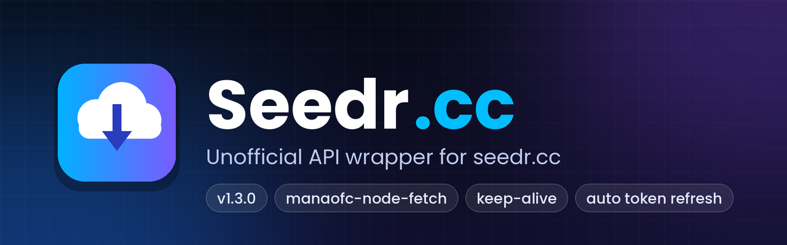

<p align="center">
  
</p>

# Seedr.cc Unofficial API Wrapper

Fixed & improved version of the original `seedr` package.

**Endpoints still work** (as of Nov 2026). Seedr has not removed the old Chrome / XBMC OAuth endpoints.

## What's new in 1.3.0

- 🔁 **`axios` and `form-data` removed** — HTTP is now handled by [`manaofc-node-fetch`](https://github.com/manaofc/manaofc-node-fetch) (one dependency instead of two)
- ⚡ **Faster**
  - Shared **keep-alive** connection → no new TCP/TLS handshake for every request
  - `getVideos()` now loads all folders **in parallel** instead of one by one
  - Concurrent requests that hit an expired token share **one** token refresh
- 🛡️ Token auto-refresh now also covers `getRoot()` / `getFolder()` (before: only POST calls)

## Install

```bash
npm install seedr
# or, if you use the files in this folder directly:
npm install manaofc-node-fetch
```

> `manaofc-node-fetch` is an **ESM-only** package, but you do **not** need to change anything —
> this wrapper loads it internally with `import()`, so both of these work:
>
> ```js
> const Seedr = require("seedr");   // CommonJS
> import Seedr from "seedr";        // ESM
> ```

Requires Node.js **16+**.

## Quick Start

```js
const Seedr = require("seedr");
const seedr = new Seedr();

// Method 1: email + password (short lived token)
await seedr.login("you@email.com", "password");

// Method 2: Device code (long lived ~1 year token) — recommended
const codes = await seedr.getDeviceCode();
// → Go to https://www.seedr.cc/devices and enter the user_code
// After authorizing:
await seedr.getToken(codes.device_code);

// Method 3: reuse old token
await seedr.addToken("your_access_token", "optional_refresh_token");
```

## Main Methods

| Method | Description |
|--------|-------------|
| `login(email, pass)` | Login with password |
| `getDeviceCode()` | Start device auth flow |
| `getToken(device_code)` | Finish device auth |
| `addToken(token, refresh?)` | Use existing token |
| `refreshAccessToken()` | Refresh expired token |
| `addMagnet(magnet)` | Add magnet link |
| `getVideos()` | List all video files (folders fetched in parallel) |
| `getContents()` | Root folders + files + space |
| `getRoot()` | Raw root folder listing |
| `getFolder(id)` | Get one folder |
| `getFile(id)` | Get direct download URL for a **file** |
| `getDownloadUrl(id)` | Same as above (convenience) |
| `createArchive(folderId)` | Create ZIP of folder → returns `archive_url` |
| `getArchiveUrl(folderId)` | Convenience for archive download link |
| `deleteFile(id)` | Delete file |
| `deleteFolder(id)` | Delete folder |
| `rename(id, name, type)` | Rename file or folder |

## Example

```js
const Seedr = require("seedr");
const seedr = new Seedr();

(async () => {
  await seedr.login("email@example.com", "password");

  // Add torrent
  const add = await seedr.addMagnet("magnet:?xt=urn:btih:...");
  console.log(add);

  // List videos
  const videos = await seedr.getVideos();
  console.log(videos);

  // Get direct download link for a single file
  if (videos[0]?.[0]) {
    const file = await seedr.getFile(videos[0][0].id);
    console.log("File download:", file.url);
  }

  // Get archive (ZIP) download link for a whole folder
  // → https://www.seedr.cc/download/archive/...?token=...&exp=...
  const archive = await seedr.createArchive(videos[0][0].fid);
  console.log("Archive link:", archive.archive_url);
})();
```

## Error handling

Every method rejects with a plain `Error` whose message says what failed:

```js
try {
  await seedr.login("email@example.com", "wrong");
} catch (err) {
  console.error(err.message); // "Login failed: <reason from Seedr>"
}
```

If a request comes back `401` / `access_denied` and a `refresh_token` is available, the token is refreshed
once automatically and the request is retried.

## Notes

- Password login uses `client_id=seedr_chrome`
- Device code uses `client_id=seedr_xbmc` (longer token lifetime)
- Token refresh is supported if you keep the `refresh_token`
- Official Seedr REST API (Basic Auth / new OAuth) is separate and mostly Premium-only
- This wrapper uses the same unofficial endpoints that the old Chrome extension & Kodi addon used — they still respond correctly in 2026

## Changelog

### 1.3.0

- Replaced `axios` + `form-data` with `manaofc-node-fetch` (multipart bodies use its built-in `FormData`)
- Keep-alive HTTPS agent shared across all requests
- `getVideos()` fetches folders in parallel
- Single shared token refresh when several requests expire at once
- Auto-retry on 401 now also applies to `getRoot()` / `getFolder()`
- Token / ids are URL-encoded in GET requests
- Added README banner image

### 1.2.0

- Added proper error messages
- Added `refreshAccessToken()`
- Added `getContents()`, `getRoot()`, `getFolder()`, `rename()`
- Auto-retry once on 401 using refresh token
- Better FormData handling
- Cleaner code structure
